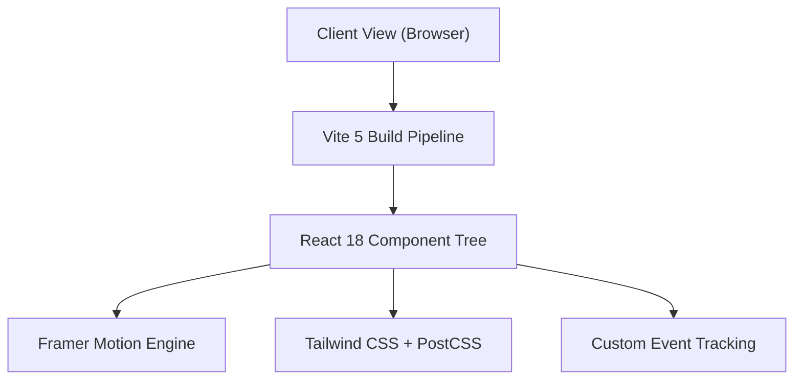

<div align="center">

# ⚡ Jal Patel — Developer Portfolio

**Full Stack Developer & UI Craftsman**  
Crafting high-performance, architecturally sound digital products with modern React, scalable Node.js systems, and precision design.

[](https://jalpatel.vercel.app/)
[](https://react.dev/)
[](https://vitejs.dev/)
[](https://tailwindcss.com/)
[](https://www.framer.com/motion/)

<br />

```
🟢 Status: Open for SDE / Full-Stack Internships, Hackathons & Select Engagements
📍 Location: Gujarat, India (Open to Remote & Relocation)
```

</div>

---

## 🧭 Overview & Engineering Philosophy

This repository contains the source code for my personal developer portfolio — engineered from the ground up to reflect modern frontend engineering standards, performance optimization, and refined UI/UX design.

### 🎯 Key Engineering Goals:
- **Zero-lag 60fps Animations**: Powered by Framer Motion's spring-physics and CSS GPU acceleration (`transform`, `will-change`, and composited layers).
- **Linear/Vercel Studio Aesthetic**: Designed with an ambient radiant light beam, technical dot-grid canvas, and dual-layer hardware glassmorphism.
- **Interactive Cursor Spotlight Engine**: Custom reusable [`SpotlightCard`](src/components/SpotlightCard.jsx) with dynamic radial hover tracking and `mask-composite` border illumination.
- **Production Asset Hygiene**: Clean build footprint, optimized raster & SVG assets, sub-second HMR with Vite, and fully responsive fluid typography via CSS `clamp()`.

---

## 🛠️ Tech Stack & Architecture



| Domain | Technologies & Libraries |
|---|---|
| **Core Framework** | React 18, JSX, Hooks (`useRef`, `useSpring`, `useScroll`) |
| **Build & Tooling** | Vite 5, PostCSS, Autoprefixer, ESBuild |
| **Styling & Design System** | Tailwind CSS 3, Custom CSS Variables, Glassmorphism, Dual Inset Borders |
| **Motion & Physics** | Framer Motion (Spring dynamics, `AnimatePresence`, Keyframe interpolations) |
| **Interactive Canvas** | HTML5 Canvas 2D ambient star-dust system with dynamic resize observers |
| **State & Navigation** | Client-side Section Observers, Modals, Category Filter Pipelines |

---

## 🏆 Featured Flagship Builds

A curated showcase of full-stack platforms, hackathon projects, and high-fidelity frontends featured in the portfolio:

| Project | Category / Context | Tech Stack | Live Demo | Repository |
|---|---|---|:---:|:---:|
| **PramaanSetu** | Smart India Hackathon (SIH) | React, Node.js, Express, MongoDB | [Live Site](https://pramaansetu.vercel.app) | [GitHub](https://github.com/Dev1822/SIH-Syntax-Squad.git) |
| **AI Cost Intelligence** | Hackathon 2026 | React, AI Analytics, Financial Dashboards | [Live Site](https://al-cost-intelligence-dashboard.vercel.app/) | [GitHub](https://github.com/jalpatel2646/Al-Cost-Intelligence-Dashboard.git) |
| **Tripora Travels** | Smart Travel & Community Platform | React, Node.js, Express, MongoDB | [Live Site](https://tripora-travels.vercel.app/) | [GitHub](https://github.com/jalpatel2646/Tripora.git) |
| **True Value Clone** | Full-Stack E-Commerce Platform | React, Redux, Tailwind, Node, MongoDB | [Live Site](https://truevalueclone.netlify.app/) | [GitHub](https://github.com/jalpatel2646/truevalue-clone) |
| **Reel Creator Portfolio** | Luxury Digital Portfolio | HTML5, Modern CSS3, JavaScript | [Live Site](https://darling-blini-47b4d8.netlify.app) | — |
| **Shoes Luxury Brand** | Editorial Fashion E-Commerce | Responsive UI, Gallery, Filtering | [Live Site](https://precious-platypus-02be70.netlify.app) | — |
| **Corkcicle Showcase** | Premium Drinkware Landing Page | Vanilla Web Animations, CSS Micro-interactions | [Live Site](https://cockcicleclone.netlify.app/) | [GitHub](https://github.com/jalpatel2646/websiteclone-3) |

---

## 📂 Project Structure

```
jal-portfolio/
├── public/                     # Static production assets
│   ├── true-value-preview.jpg  # Decoded image assets
│   ├── sports-app-ui-preview.png
│   ├── mobile-prototype-preview.png
│   └── Jal_Patel_Resume.pdf    # Downloadable resume
├── src/
│   ├── components/
│   │   ├── SpotlightCard.jsx   # 🌟 Aceternity/Linear-style dynamic spotlight card
│   │   ├── Navbar.jsx          # Glassmorphic sticky header with quick links
│   │   ├── Hero.jsx            # 2026 hero with role-flipper, status pill & tech shelf
│   │   ├── About.jsx           # Background, bio, and social channels
│   │   ├── Skills.jsx          # Interactive skill matrix across frontend, backend & tools
│   │   ├── Projects.jsx        # Project grid with categorized filtering & detail modal
│   │   ├── HackathonProjects.jsx # High-velocity hackathon live builds
│   │   ├── Hackathons.jsx      # Hackathon milestones & timeline
│   │   ├── FigmaDesigns.jsx    # UI/UX interactive Figma prototypes
│   │   ├── Achievements.jsx    # LeetCode 235+ milestones & interactive cards
│   │   ├── ProblemSolving.jsx  # Algorithmic & data structures profile
│   │   ├── Experience.jsx      # Career & practical development timeline
│   │   ├── Contact.jsx         # Direct outreach and contact form
│   │   ├── Footer.jsx          # Navigation, socials, and dynamic copyright bar
│   │   ├── Loader.jsx          # Smooth intro loading sequence
│   │   └── SectionWrapper.jsx  # Reusable scroll-triggered viewport wrapper
│   ├── utils/
│   │   └── analytics.js        # Privacy-first event & interaction telemetry
│   ├── App.jsx                 # Root layout with top light beam & dot grid canvas
│   ├── index.css               # Design tokens, keyframes & hardware glassmorphism
│   └── main.jsx                # Application mounting point
├── tailwind.config.js          # Custom theme configuration
├── vite.config.js              # Vite server & bundler settings
└── package.json                # Project dependencies & build scripts
```

---

## 🚀 Local Development Setup

Clone the repository and spin up a development server in seconds:

### Prerequisites
- **Node.js**: v18.0.0 or higher
- **npm**: v9.0.0 or higher

### Installation & Run

```bash
# 1. Clone the repository
git clone https://github.com/jalpatel2646/my_portfolio.git

# 2. Enter project directory
cd my_portfolio/jal-portfolio

# 3. Install dependencies
npm install

# 4. Start local development server
npm run dev
```

Open your browser at `http://localhost:5173` to view the live site with Hot Module Replacement (HMR).

### Production Build & Preview

```bash
# Generate optimized production bundle in /dist
npm run build

# Preview production build locally
npm run preview
```

---

## 📬 Connect & Collaborate

I'm always eager to collaborate on ambitious software products, contribute to high-impact hackathon teams, or explore full-time software engineering roles.

- **Portfolio**: [jalpatel.vercel.app](https://jalpatel.vercel.app)
- **LinkedIn**: [linkedin.com/in/jal-patel-b7a4a7394](https://www.linkedin.com/in/jal-patel-b7a4a7394/)
- **GitHub**: [@jalpatel2646](https://github.com/jalpatel2646)
- **LeetCode**: [@jall_patel](https://leetcode.com/u/jall_patel/)
- **X / Twitter**: [@JalPatel97246](https://x.com/JalPatel97246)
- **Email**: [jal.h.patel.cg@gmail.com](mailto:jal.h.patel.cg@gmail.com)

---

<div align="center">
  <sub>Designed & Developed with precision by <strong>Jal Patel</strong> • © 2026 All Rights Reserved</sub>
</div>
